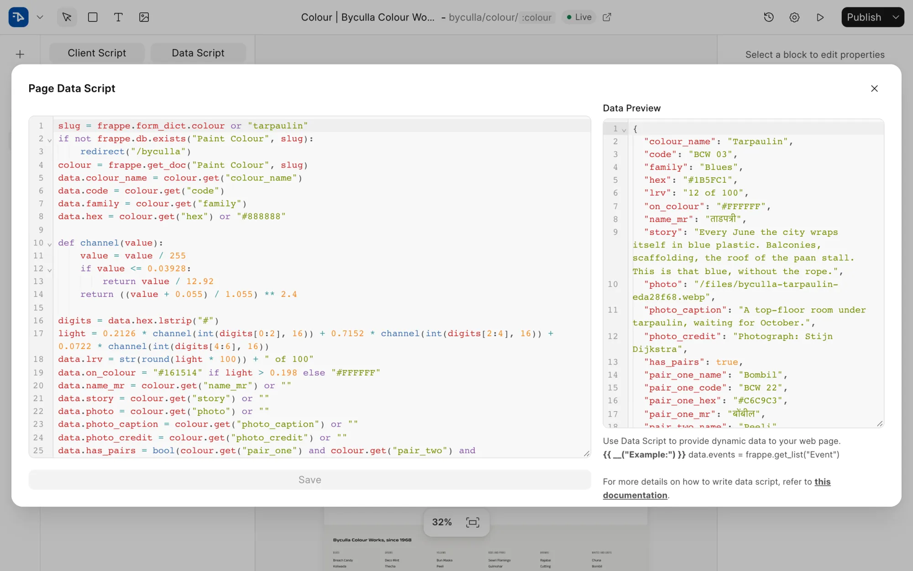
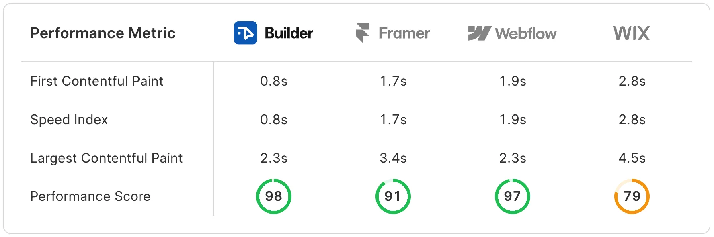

<div align="center">

<a href="https://frappe.io/products/builder">
    
</a>


<h1>Frappe Builder</h1>

**Crafting Web Pages Made Effortless**


[](https://github.com/frappe/builder/releases)
[](https://codecov.io/github/frappe/builder)
[](https://github.com/frappe/builder/actions/workflows/server-tests.yml)

<a href="https://trendshift.io/repositories/17380?utm_source=trendshift-badge&amp;utm_medium=badge&amp;utm_campaign=badge-trendshift-17380" target="_blank" rel="noopener noreferrer"></a>

<div>
    <picture>
        <source media="(prefers-color-scheme: dark)" srcset="https://github.com/user-attachments/assets/7b013cc1-fe40-4b3c-a765-d8c3697bf81e">
        
    </picture>
</div>

[Website](https://frappe.io/builder) - [Documentation](https://docs.frappe.io/builder)
</div>

## Frappe Builder

Frappe Builder is a low-code website builder designed for simplicity, speed, and flexibility. Craft beautiful websites effortlessly with an intuitive visual builder. Whether you're a designer looking for ease or a developer seeking customization, Frappe Builder empowers you. It also features a click-to-publish option that gives you the complete end-to-end website creation experience.

### Motivation

Most existing solutions were either too complex, too restrictive, or difficult to integrate with the Frappe ecosystem. Additionally, pages built with these tools were often bloated with unnecessary scripts and styles. I wanted to take a stab at solving this problem while prioritising performance from day one. I aimed to address two major issues with this project: providing an intuitive way to design a web page and enabling one-click publishing. As a web developer, it helps me scratch my own itch, and I hope it helps others too.

### What Sets It Apart

- **Bob, an AI builder that reads your site first.** Ask for a page or a change in plain words. Before it edits, Bob reads your existing pages, theme tokens and components, so new work follows your design language and fits your routes. It wires forms and data sections to real doctypes and looks facts up online instead of inventing them. Sensitive changes wait for your approval, and every AI edit can be reverted.

  

- **Your Frappe database is the CMS.** A page or component can run a Python data script that fetches from any doctype, then loop over the results and bind them to any property or style. A dynamic route like `/blog/:slug` turns one design into a page for every record, with no separate CMS or API to maintain.

  <picture>
    <source media="(prefers-color-scheme: dark)" srcset=".github/assets/data-script-dark.webp">
    
  </picture>

- **Components with props and scripts.** Turn any group of blocks into a reusable component with typed props, its own data script and its own client script. Change it once and every page that uses it follows.

- **Fast by default.** Published pages are lean HTML and CSS with no front-end framework to load before they render. [frappe.io](https://frappe.io) runs on Builder.

  

  <sub>Google Lighthouse (mobile) on nearly identical test pages built with each platform, as published on [frappe.io/builder](https://frappe.io/builder).</sub>

- **Works with your coding agent.** The [`frappe-builder`](skills/frappe-builder/SKILL.md) skill lets Claude Code, Codex, OpenCode and other agents build, edit and publish pages on any Frappe site. See [With a Coding Agent](#with-a-coding-agent).

### Under the Hood

- [Frappe Framework](https://github.com/frappe/frappe): A full-stack web application framework.
- [Frappe UI](https://github.com/frappe/frappe-ui): A Vue-based UI library, to provide a modern user interface.


## Getting Started (Production)

### Managed Hosting

Get started with your personal or business site with a few clicks on Frappe Cloud - our official hosting service.
<div>
	<a href="https://frappecloud.com/builder/signup" target="_blank">
		<picture>
			<source media="(prefers-color-scheme: dark)" srcset="https://frappe.io/files/try-on-fc-white.png">
			
		</picture>
	</a>
</div>


### Self Hosting

[Pilot](https://github.com/frappe/pilot) is Frappe's tool for running benches and sites on your own server. It installs Frappe, manages sites and backups, and sets up production with nginx and TLS. Production runs on Linux (macOS works for local development), it needs Frappe v16 or later, and it is still in pre-release.

**Step 1**: Install Pilot

```bash
curl -fsSL https://raw.githubusercontent.com/frappe/pilot/develop/install.sh | bash
```

**Step 2**: Create a bench. The first `start` prints the URL of a setup wizard, where you pick the Frappe branch (`version-16`) and set passwords.

```bash
pilot new main
pilot -b main start
```

**Step 3**: Add Builder and create your site

```bash
pilot -b main get-app https://github.com/frappe/builder --branch master
pilot -b main new-site subdomain.domain.tld --admin-password <password>
pilot -b main install-app subdomain.domain.tld builder
```

**Step 4**: Go to production

```bash
pilot -b main setup production --admin-domain admin.domain.tld --tls --letsencrypt-email email@example.com
```

Pilot's [production guide](https://github.com/frappe/pilot/blob/develop/docs/production.md) covers process managers, domains and TLS. To run production with bench instead, follow Frappe's [production setup](https://docs.frappe.io/framework/user/en/production-setup).

## Getting Started (Development)

### With a Coding Agent

Add the [`frappe-builder`](skills/frappe-builder/SKILL.md) skill to Claude Code, Codex, OpenCode or another coding agent:

```bash
npx skills add frappe/builder
```

Then ask it to set up a local Builder site. The skill reuses a bench you already have or creates one, connects through [frappectl](https://github.com/frappe/frappectl), and from there edits, builds and publishes pages for you, locally or on any Frappe site you sign in to.

### Pilot

On Linux or macOS, [install Pilot](#self-hosting) and create a bench. In the setup wizard, pick Frappe's `develop` branch.

```bash
pilot new dev
pilot -b dev start
```

In a new terminal, add Builder and create a site:

```bash
pilot -b dev get-app https://github.com/frappe/builder --branch develop
pilot -b dev new-site builder.localhost
pilot -b dev install-app builder.localhost builder
pilot -b dev frappe --site builder.localhost set-config ignore_csrf 1 # prevents CSRFToken errors while using the vite dev server
```

Open [http://builder.localhost:8000/builder](http://builder.localhost:8000/builder) and log in as `Administrator` / `admin`. Pilot moves to the next free port if 8000 is taken.

### Existing Bench

If you already have a [bench](https://docs.frappe.io/framework/user/en/installation) on Frappe's `develop` branch, run `bench start` and keep it running. Then, in a new terminal inside `frappe-bench`:

```bash
bench get-app builder --branch develop
bench new-site builder.localhost --install-app builder
bench browse builder.localhost --user Administrator
bench --site builder.localhost set-config ignore_csrf 1 # prevents CSRFToken errors while using the vite dev server
```

The editor is at `builder.localhost:8000/builder`.

### Docker

You need Docker, docker-compose and git setup on your machine. Refer [Docker documentation](https://docs.docker.com/). After that, run following command:

**Step 1**: Setup folder and download the required files

```bash
mkdir frappe-builder && cd frappe-builder
wget -O docker-compose.yml https://raw.githubusercontent.com/frappe/builder/develop/docker/docker-compose.yml
wget -O init.sh https://raw.githubusercontent.com/frappe/builder/develop/docker/init.sh
```

**Step 2**: Run the container

```bash
docker compose up
```

Wait until the setup script creates a site and you see `Current Site set to builder.localhost` in the terminal. Once done, the site [http://builder.localhost:8000](http://builder.localhost:8000) should now be available.

**Credentials:**
Username: `Administrator`
Password: `admin`

### Frontend Development

In a new terminal, from `apps/builder` inside your bench:

```bash
yarn dev-setup
yarn dev --host
```

Now, you can access the site on vite dev server at `http://builder.localhost:8080`

**Note:** You'll find all the code related to Builder's frontend inside `apps/builder/frontend`

<h2></h2>

### Links

- [Telegram Public Group](https://t.me/frappebuilder)
- [Discuss Forum](https://discuss.frappe.io/c/frappe-builder/83)
- [Documentation](https://docs.frappe.io/builder)
- [Figma Plugin (Beta)](https://www.figma.com/community/plugin/1417835732014419099/figma-to-frappe-builder)
- [Frappe Script Editor](https://github.com/frappe/frappe-script-editor)
- [Translations](https://crowdin.com/project/frappe)

<br>
<br>
<div align="center">
	<a href="https://frappe.io" target="_blank">
		<picture>
			<source media="(prefers-color-scheme: dark)" srcset="https://frappe.io/files/Frappe-white.png">
			
		</picture>
	</a>
</div>
