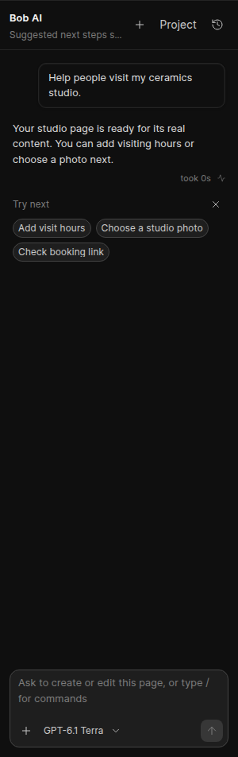

# Turn budget and model-authored next steps

The reported failed turn had completed nine coordinator calls, reserved 272,036 tokens and reported 103,430 actual tokens. A tenth call would exceed the default 300,000-token cumulative reservation. The configured model context was 500,000 tokens; the last request's estimated input was 15,514 tokens. The turn limit, rather than the model's context, stopped this work.

The default cumulative reservation is now **1,000,000 tokens**. `bob_run_token_budget` still overrides it. Reservations remain conservative estimates of input plus maximum output across calls, not billed usage. The effective limit is recorded in run metadata. Dedicated safe messages distinguish turn-budget exhaustion, context overflow and missing tool/streaming capabilities.

Existing automatic compaction is retained: older tool results become bounded notes, the latest three tool rounds stay intact, and older context units are removed when needed to fit a request. This preserves the current marked request and tool-call/result pairing. It is deterministic trimming, not an additional model summarization call; it does not reset accumulated reservations. Saved briefs and decisions remain durable.

Bob now uses `finish_response(message, next_steps)` for its ordinary final response. The answer and up to three optional suggestions are generated together through the existing model/tool transport. This terminal tool ends the turn immediately, with no extra suggestion call. Suggestions are validated, deduplicated and bounded to 60-character labels and 600-character prompts. Both run and chat metadata retain them, and the completion event delivers them immediately.

The frontend renders those saved suggestions. The keyword rules and generic next-step fallback are removed. Plain replies and older messages without suggestions remain usable and show no chips. Clicking a chip fills and focuses the composer; it does not submit a request. Existing onboarding starters are separate and remain curated prompts.

## Validation

- **57 backend tests passed**, including the previously rejected tenth-call reservation, the new limit and explicit overrides, unchanged model context enforcement, distinct safe errors, automatic compaction/pairing and a complete mocked response through the real agent loop and database transcript. The latter asserts one model call, one completion and identical stored/emitted suggestions.
- **38 frontend tests passed**, including immediate completion metadata, refresh persistence, malformed suggestions, no keyword fallback, selection and dismissal.
- **Five deployed browser checks passed:** real persisted suggestions render, survive refresh, fill/focus an editable prompt without submitting, dismiss, and disappear for old replies without metadata. The browser used a synthetic reply persisted through the real `finish_response` handler. No model requests were sent. The overall zero-browser-error assertion remains red due to the same three external Builder Hub catalog CORS failures; these are retained in the report, not suppressed.
- Production build, Ruff and whitespace checks passed. The project TypeScript check retains **37 diagnostics outside changed files**, with none in the changed frontend files.
- Live model transports were mocked or blocked. Suggestion relevance from actual models still needs live evaluation.

The [public test site](https://slight-max-printed-worthy.trycloudflare.com/builder/) has this build. Web and async runtime processes were restarted after verifying no real-model runs were active. The effective default was checked at 1,000,000 tokens. User model/provider settings were preserved, and the temporary smoke page and session were removed. Raw logs are in `/home/t3run/bob-test-deploy/logs/bob-budget-chips-tests.log`, `bob-budget-chips-build.log`, `bob-budget-chips-typecheck.log`, and `bob-suggestion-browser-results.json`.

Current initial system/schema text estimates **5,540 tokens** using the same estimator, excluding dynamic page/history context and output. The extra final-response contract therefore has a small per-round cost; it does not create a separate recommendation call.

