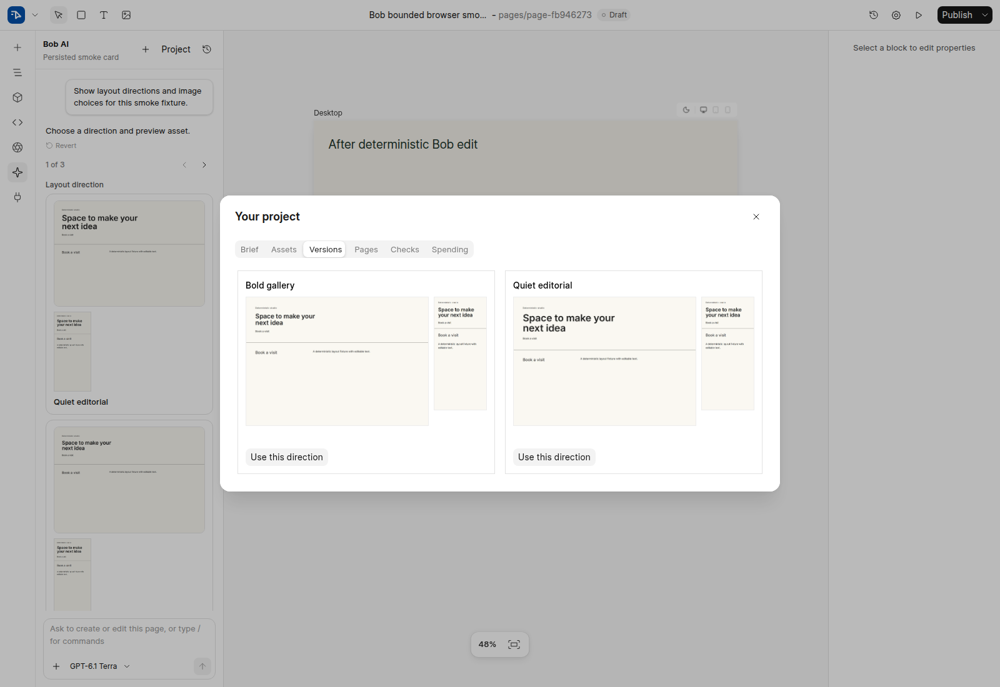

# Bob guided-design experiment — implementation and validation

Draft [PR #1023](https://github.com/frappe/builder/pull/1023) extends the original reliability work with native raster directions, durable design/project state, asset acquisition/generation, verification and an async orchestration service. [Current review coverage](pr-1023-coverage.md) maps every numbered finding and distinguishes implementation from evaluation.

## Behavior

For a vague new-site request, Bob can gather consequential context, save the brief and show actual desktop/mobile WebP layout choices. Applying a choice promotes the exact editable blocks that produced its previews. More detailed requests can build directly. Users can correct facts, classify uploaded images, inspect versions, track page tasks, review checks and reconcile media spending in Project. SVG icons/illustrations remain supported where appropriate; SVG sketches are not the direction-preview path.

Original uploads and selected stock retain identity/provenance. Magnific acquisition requires configured account entitlement and a confirmation. Optional generated artwork uses cached raster requests and conservative budget reservations. Ambiguous paid results require reconciliation; unknown charges are never reported as zero. References cannot silently become final page artwork.

Model context starts with a small core and loads specialist instructions/tools on demand. Large results live behind artifact cursors. Model capabilities and context/output/run reservations constrain calls; failed repairs are bounded. A versioned brief retains facts, rejected ideas and assets beyond rolling chat history. Static initial text measured **4,748 tokens** with `o200k_base`, compared with **21,719** in the original audit. This ~78% reduction excludes dynamic page/history/images, provider framing/caching, output and repair costs.

The async service awaits chat, generation and research model I/O without occupying an RQ worker or keeping a DB connection open. Ordinary tools use a bounded thread pool; sensitive confirmations still use their web request. Durable runs, event cursors, revision checks and effect receipts preserve committed work across reconnects and failures. Shutdown/crash recovery does not resume an arbitrary Python stack or replay an uncertain purchase. [Runtime setup](../../builder/ai/RUNTIME.md).

Revert restores page/chat and tracked shared effects only when their revisions still match. It refuses a range containing confirmed external/schema/plugin/global actions, keeping history intact. All mutating Bob API endpoints require POST. Static direction templates use an isolated sandbox with only native layout filters and an empty standard-script include; they cannot access Frappe globals or arbitrary templates. Page deletion removes its artifacts, scoped memory and run journal and refuses active runs, applying actions or unresolved media requests. Project tasks can recreate a deleted draft without retaining stale completion evidence.

## Validation performed

| Check | Result and actual boundary |
| --- | --- |
| Backend | **412 tests passed** on isolated MariaDB/Redis/Frappe. Live model/image/stock transports guarded. Covers run/session/permissions, canonical operations, effects/revisions, strict generation, media, scopes, plugin staging and evaluation export. |
| Frontend | **74 tests passed** across eight focused files: controller recovery/races, cards, journal ordering, plugin registration/disposal and loader rollback. |
| Chromium fixture suite | **Eight groups passed**: no-JS content, keyboard/RTL/vertical tabs, reinstall/disposal, reduced motion, tall footer/disclosure, responsive reflow, known accessibility defect detection and interaction assertions. |
| Native browser verifier | Five actual Frappe Chromium steps passed: hidden content → click disclosure → visible → Space → hidden, with zero runtime errors. A visibility check was corrected after this exposed closed-details geometry differences. |
| Live published forms | Guest and authenticated delivery plus retry produced exactly three DB rows with correct reserved name, boolean, radio, multi-select and checkbox-group values. Required fields prevented sends; double submit issued one request; simulated transport failure preserved inputs; retry reached the real endpoint; guest record read returned 403. |
| Async integration | Two concurrent mocked provider streams completed with zero RQ jobs. A third silent wait cancelled promptly; committed events were contiguous and final states were complete/complete/cancelled. No real provider call. |
| External reference | Real bounded fetch/Chromium rendering of a public reference produced a WebP and DOM/style summary. Public-only transport/network limits remain explicit; dynamic API/frame-dependent content may be incomplete. |
| Public editor | Normal login, real WebP MIME/decoding, desktop/mobile Versions, card selection/source links, refresh persistence and actual API Revert passed. New dialog API mismatch found and fixed; workspace uses frappe-ui Tabs for keyboard behavior. |
| Build/static checks | Production build, Ruff lint/format and whitespace checks passed. TypeScript has **37 diagnostics outside modified files**; the full project check remains failing. |

The test site has a provider and three models configured by the user; validation preserved that setup and blocked model submissions from its smoke browser. The outside Builder Hub catalog returns a CORS error on this temporary origin. These errors are retained in the report, so the whole editor is not described as error-free.

GitHub CI exposed the method restrictions and audit-probe lint gaps above; they were fixed. The form DOM harness now declares and resolves its `jsdom` development dependency from the frontend workspace. Local differential Semgrep reports zero new blocking findings. The dependency audit flags the unchanged `litellm==1.95.1` pin for **CVE-2026-114612** (LiteLLM proxy authentication/privilege escalation). Builder uses the client SDK, and this change does not upgrade or suppress that dependency finding.

## Public experiment and evidence

[Open Builder](https://slight-max-printed-worthy.trycloudflare.com/builder/). The isolated bench uses `bob-test.localhost` internally and is separate from the existing bench checkout. The async daemon and recovery scheduler are enabled. The Quick Tunnel lasts while its process runs; host restart supervision and a permanent hostname remain deployment work. Credentials remain in private deployment storage and are not part of this repository.

Raw validation logs and temporary harnesses are under `/home/t3run/bob-test-deploy/logs/` and `/tmp/bob-*` in the experiment environment. The [machine-readable evidence summary](evidence-2026-11-02.json) and screenshot below preserve the key results in the PR. Named browser/form fixtures and two earlier preview fixtures were removed after their checks.

## Limits that need an experiment, not a passing unit test

No paid model, generated-image or stock acquisition request was made during this validation. Account licensing/production provider contracts need verification before enabling acquisition. The six-case live corpus, explicit acceptance/correction recording and blind comparison exporter are implemented but have not been run with real model output. [Reproduction instructions](../../builder/ai/acceptance/README.md).

All 82 scenarios have traceable required outcomes: 70 currently have partial deterministic evidence and 12 need evaluation. Pairwise plans are generated as `not_run`. No claim of exhaustive scenario success, measured design improvement, cost-to-acceptance reduction, screen-reader conformance or MotionSites-level aesthetics is supported yet.

Native variant specs/canonical blocks serve as the design representation; there is no second universal PageSpec compiler. The tested interaction library starts with reveal, tabs and disclosure, with bounded generic browser assertions for custom controls. Bespoke 3D/video scenes, shared component dependency migration, advanced font/contrast checks and third-party recipe catalogs remain explicit integration/evaluation boundaries.
