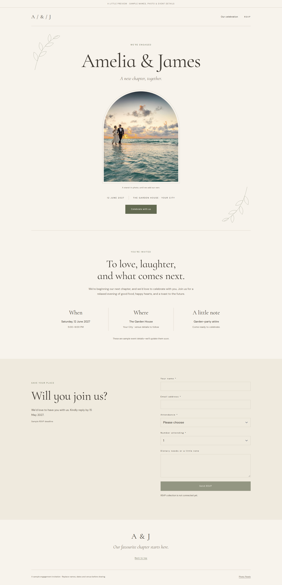

# Published fonts and colours: deployment correction

The [engagement sample](https://slight-max-printed-worthy.trycloudflare.com/pages/page-a8bfd2a2) now renders its Cormorant Infant headings, DM Sans body text, paper background and olive/brown palette. The fault was in the isolated experiment's nginx configuration. No Builder source, page content, token records, scripts or RSVP behavior changed.

## Confirmed cause

The thumbnail fix in the [original deployment](public-deployment.md#deployment-issue-fixed) used a static alias for all of `/builder_assets/`. That directory also contains two Frappe-rendered CSS templates: `tokens.css` and the compatibility route `variables.css`. nginx returned raw Jinja with HTTP 200 and `text/css`, so response-status checks alone missed the failure.

Before correction, the public token stylesheet began with ``. The same URL directly through Frappe on port 8032, with `X-Frappe-Site-Name: bob-test.localhost`, returned valid `:root` declarations for all six `--engagement-*` variables. Chromium showed an empty `--engagement-display`, an Inter/system heading font, black text and a transparent root background.

Changed `/home/t3run/bob-test-deploy/nginx.conf` to serve only image extensions statically. CSS now follows the ordinary Frappe proxy, preserving site selection and Frappe cache behavior. Both current and legacy CSS routes render; standard thumbnails still work. The existing dotfile and source-file denials remain in place. nginx configuration validation and graceful reload passed. No backend/runtime restart, build or migration was needed.

The original response allowed one hour of browser caching. Previously opened tabs may need one hard reload (Cmd+Shift+R on macOS, Ctrl+Shift+R on Windows/Linux). The corrected response uses Frappe's `private,max-age=300,stale-while-revalidate=10800` policy. This change cannot evict an already-fresh browser cache entry.

## Verification

[Read-only browser probe](probes/published-tokens.cjs), run against the public HTTPS URL:

```bash
PLAYWRIGHT_MODULE=/tmp/r3/node_modules/playwright \
CHROMIUM_EXECUTABLE=/home/t3run/.cache/ms-playwright/chromium-1243/chrome-linux64/chrome \
BOB_EVIDENCE_DIR=/home/t3run/bob-test-deploy/logs/published-tokens \
node reviews/bob/probes/published-tokens.cjs \
  https://slight-max-printed-worthy.trycloudflare.com/pages/page-a8bfd2a2
```

Passed:

- Both CSS routes return parsed `:root` content, without template delimiters, containing all six expected variables.
- Two standard PNG thumbnails return HTTP 200 with the image MIME type, including a URL with a space.
- At 1440, 768 and 390 px, all six token values match; heading/body fonts are loaded; heading colour is `rgb(62, 57, 50)` and paper background is `rgb(247, 243, 236)`.
- All page images load, there is no horizontal overflow, and no page errors or failed requests occur.
- A separate Chromium DevTools check confirms the heading actually uses the downloaded Cormorant Infant font for all 14 glyphs, beyond merely declaring it in computed CSS.
- An independent routing review matched both stylesheets to direct Frappe responses, checked query strings, compared four PNG/WebP assets to disk, verified missing-image 404s, and confirmed old template-file conditional validators receive corrected CSS with HTTP 200. No remaining defect was found in the scoped nginx correction.

T3 preview was unavailable with the reported host AppArmor error, so verification used the existing local Chromium fallback. No credentials, model calls, form submissions, page writes or fixtures were needed. This smoke covers the published page; it does not re-certify the editor or its unrelated external catalog.

[Machine-readable results](evidence/published-tokens.json). Full before/after screenshots and HTTP captures remain under the isolated deployment's `logs/` and `/tmp/bob-tokens-*`. The previous nginx configuration is backed up at `logs/nginx-before-token-fix.conf`.



## Separate source-review findings

Parallel read-only source reviews identified independent follow-ups: explicit token IDs could fall back to a different same-label record; font fallback normalization and mixed-case custom properties could lose information; editor background parsing dropped unsupported variable shorthands; and font discovery did not resolve arbitrary block-local variables. These did not cause this incident: the live token records, rendered declarations and font links were already correct. A later application change in this PR addresses these source issues separately from the deployment correction.
