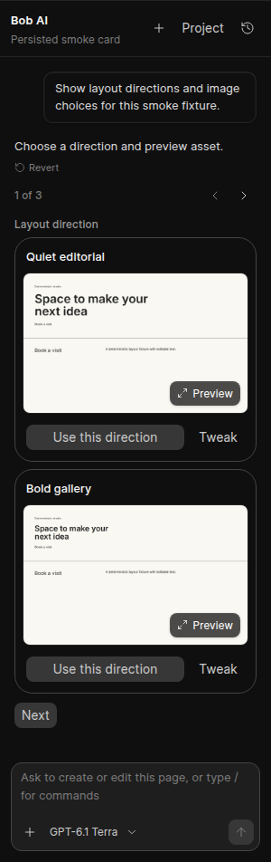
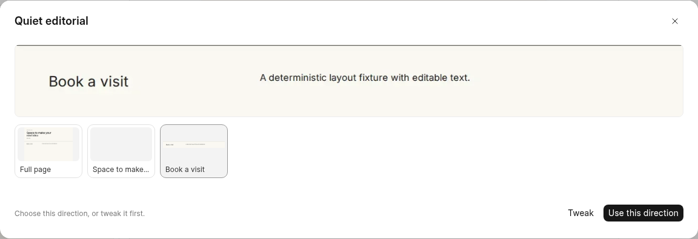
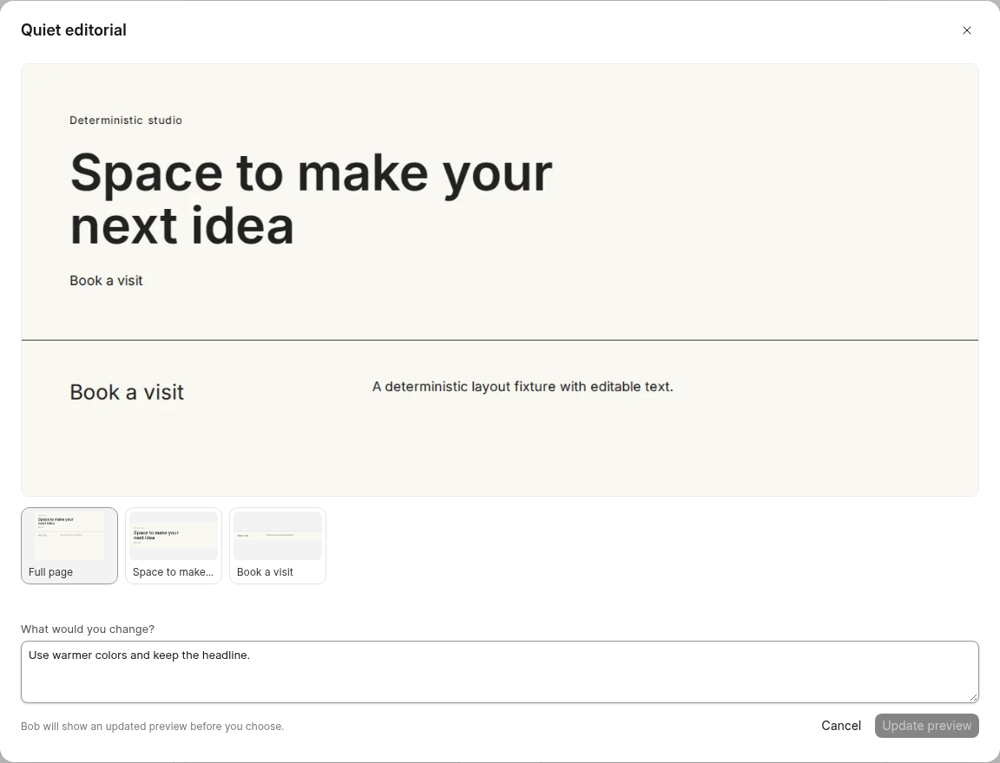
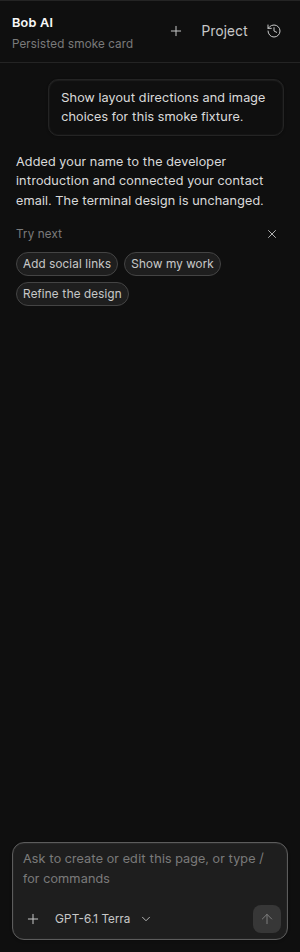
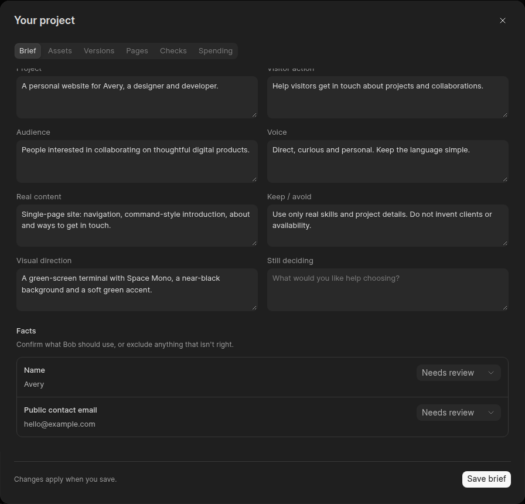
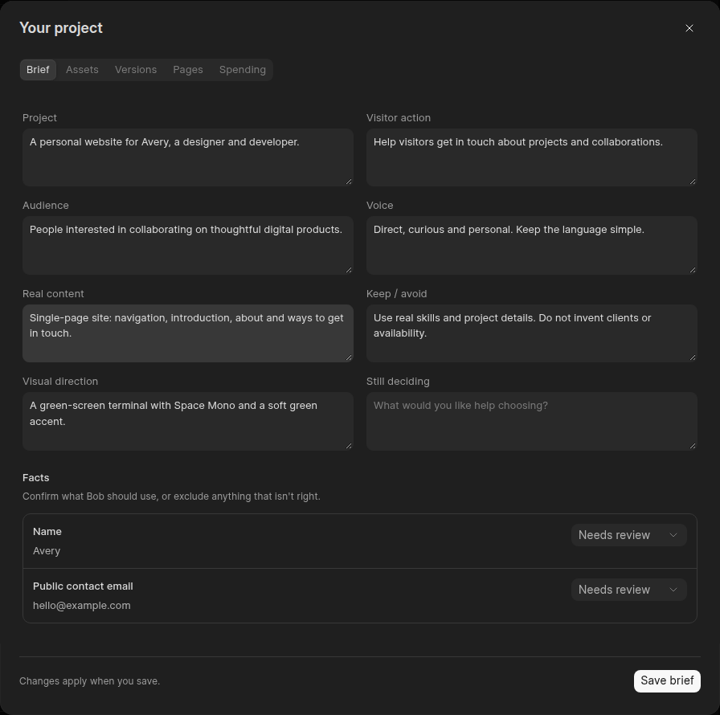

# Optional design previews and next steps

Bob's direction cards now show one desktop screenshot with separate **Preview**, **Use this direction**, and **Tweak** actions. The enlarged preview displays the full description and optional section thumbnails. Chat and Project → Versions share the same components. Previewing, closing a dialog, and browsing sections never select a direction.

New previews capture desktop once and crop up to four visible header/navigation/section/footer/form regions from those pixels. All images are private WebP files attached to the page. There are no additional model calls or browser renders for these detail crops, and no mobile render in this optional direction picker. Existing previews remain usable; refresh them to get section details. Responsive verification still checks desktop and mobile.

**Tweak** opens an optional text field and requests an updated preview. The request is free text, without a typed card-selection answer. `read_design_direction` supplies the saved specification; `base_variant_id` lets the next variant inherit it while preserving the original artifact. Recipe palette changes merge by role, and custom layouts require edited YAML. Creating the revised variant leaves the current page unchanged. Applying a direction remains a separate choice. Live model adherence to the refinement instruction was not tested.

Completed replies can show three optional **Try next** chips. The initial version described in this validation used lightweight keyword rules. The [budget and suggestion follow-up](budget-and-next-steps-2026-11-02.md) replaces them with model-authored suggestions in Bob's normal final response, saved with the message. Clicking a chip fills and focuses an editable message without sending it. Chips hide during active work, unanswered cards, and message composition, and can be dismissed.

## Validation

- **19 backend tests passed** in `builder.ai.test_design_workflow` and `builder.ai.test_evaluation`, with live model transports blocked. Includes cache reuse with a single render, exact layout promotion, nonmutating refinement, palette preservation, custom-YAML handling, private detail crops, and clipping to captured pixels.
- **16 frontend tests passed** in the card/rendering helpers. The new regression verifies that a tweak neither selects the option nor submits a typed answer.
- **Six Chromium browser groups passed** on the public deployment: 268 px card layout; real desktop/section decoding and focus restoration; optional tweak/cancel/submission; nested Versions preview; explicit selection/stock picker/refresh persistence; contextual chips/focus/dismissal.
- Browser refinement submission was intercepted before reaching the run API. The chip scenario used a synthetic completed reply in that browser's session response. All preview images and section crops were real Frappe Chromium output. **Zero live model calls.**
- Production build, Ruff, Prettier, and whitespace checks passed. The project TypeScript check still has the same **37 diagnostics outside changed files**. The unrelated Builder Hub catalog CORS failures remain visible in the browser evidence.

The normal authenticated public site is deployed at <https://slight-max-printed-worthy.trycloudflare.com/builder/>. No migration or provider configuration changes were needed. The temporary fixture was removed after verification. Local raw evidence is in `/home/t3run/bob-test-deploy/logs/bob-design-ui-results.json`, `bob-ui-backend-tests.log`, and `bob-ui-build.log`.

## Screenshots

## Project brief layout follow-up

The Brief dialog now gives its custom content explicit theme-aware text colors. Facts and decisions use a grouped list with room for labels and values, a constrained 144 px status control, and wrapping for long text. User-facing choices are **Needs review**, **Confirmed** and **Don't use**; the stored `proposed`, `accepted` and `rejected` values are unchanged. Empty record sections are hidden. Save sits in the dialog footer outside the scrolling form, and the tab strip can scroll horizontally when space is limited. Existing brief text, including any saved design identifiers, is preserved verbatim.

The production build, Prettier and whitespace checks passed. Five focused Chromium check groups passed on the public deployment:

- Compact controls and space for fact values; no empty Decisions heading.
- Dark-theme heading, label, value, footer and input text contrast of at least 5.79:1.
- Light-theme equivalents of at least 7.80:1.
- Real API saving and reload persistence of the selected enum and an edited field; the footer remains outside form scrolling and only appears on Brief.
- A 390 px component probe with long values and populated decisions: controls stack and neither the records nor dialog overflow horizontally. Builder's existing small-screen editor blocker was hidden only in this browser to inspect the component; this does not add mobile editor support. Long values and decisions were injected into that browser's workspace response only.

The fixture used fictional example content and was removed after verification. No provider configuration or real user brief was changed, and no model run requests were made. The two recorded browser errors are the existing external Builder Hub CORS failure. Raw evidence: `/home/t3run/bob-test-deploy/logs/bob-brief-results.json`, `bob-brief-browser.log` and `bob-brief-build.log`. Browser harness adjustments handled CSS `color(srgb ...)` values and the outer Dialog scroll container correctly before the final passing run.

## Keep diagnostic reports internal

Removed the **Checks** tab, its unused report component and the workspace API's diagnostic-report projection. The workspace now contains Brief, Assets, Versions, Pages and Spending. Bob's browser checks, tool registration and saved revision-bound verification artifacts remain intact.

Updated Bob's core, preview and verification guidance to repair concrete issues itself, keep raw selectors/viewport warnings/manual-check lists internal, and mention unresolved issues only when they affect the user's goal or require input, with a clear next step. Page-task evidence should also be brief and user-facing. Requests for technical details and honest statements about relevant verification limits remain supported. This is prompt guidance; live-model adherence was not evaluated.

The production build, Python lint/format, frontend formatting and whitespace checks passed, along with the two existing interaction-boundary tests. A real-DB fixture confirmed that the workspace omits reports while the diagnostic artifact remains readable internally. Authenticated Chromium checked all five remaining tabs and the real workspace response: no Checks tab, raw diagnostic strings or model run requests. The temporary page and artifact were removed. The existing external Builder Hub CORS error remains. Raw evidence is under `/home/t3run/bob-test-deploy/logs/bob-workspace-clean-*`.

